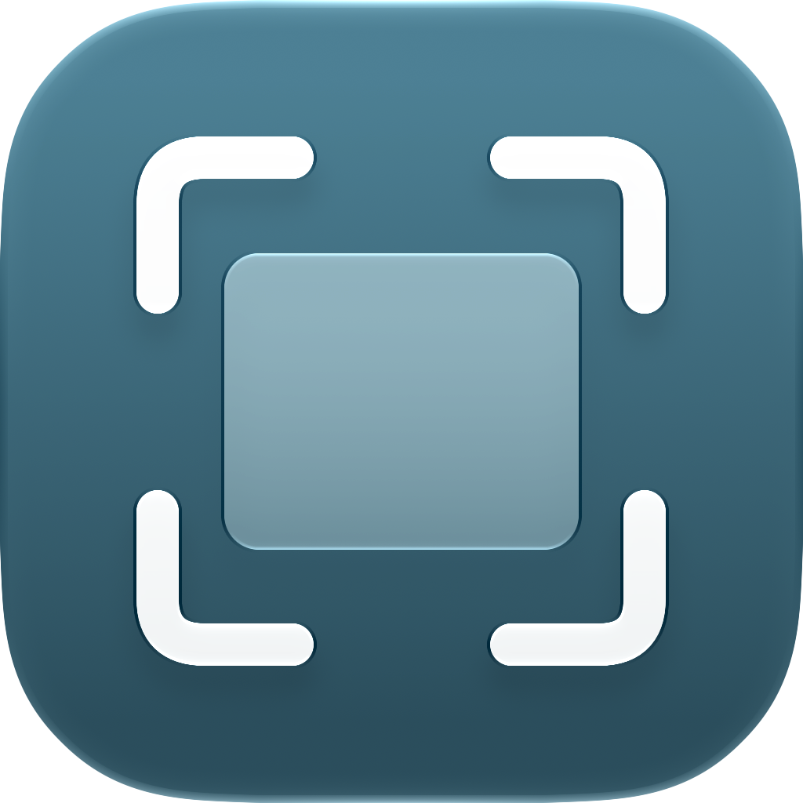

<p align="center">
  
</p>

# Knippi

Knippi ist eine schnelle, schlanke Screenshot-App für die Menüleiste des Mac. Open Source und kostenlos.

## Was Knippi kann

- **Aufnehmen:** Bereich, Fenster oder ganzer Bildschirm, mit eigenen Tastenkürzeln. Auf Wunsch übernimmt Knippi command + shift + 3, 4 und 5.
- **Schnellzugriff:** Nach der Aufnahme erscheint ein Vorschaubild in der Ecke. Von dort kopieren, sichern, teilen, annotieren oder anheften. Wahlweise öffnet sich sofort der Editor, oder Knippi sichert still.
- **Editor:** Pfeil, Linie, Rechteck, Ellipse, Text, Freihand, Textmarker, Zähler, Spotlight und Verpixeln.
- **Vertrauliches finden:** Knippi schlägt E-Mail-Adressen, Telefonnummern, IBAN, Kartennummern und Zugangsschlüssel zum Schwärzen vor und legt deckende schwarze Balken darüber.
- **Farbe aufnehmen:** Color Picker mit Lupe, mehreren Farbformaten und „Letzte Farben“.
- **Hintergründe:** Verläufe, eigene Bilder und Formate wie 16:9, 1:1 und 4:5. Fenster bleiben auf Wunsch transparent mit Schatten.
- **Texterkennung:** Text aus jedem Bildschirmbereich kopieren, auch aus Bildern und Videos.
- **Teilen:** Teilen-Menü von macOS, optional Cloud-Freigabe in den eigenen Speicher.

Die Hilfe in der App (Menü → „Knippi-Hilfe“) erklärt alles Schritt für Schritt.

## Voraussetzungen

- macOS 26 oder neuer
- Mac mit Apple Silicon

## Installieren

1. [Neueste Version](https://github.com/miwixyz/Knippi/releases/latest) laden (`Knippi-x.y.z.zip`), per Doppelklick entpacken und `Knippi.app` in den Ordner Programme ziehen.
2. Knippi starten. Das Symbol erscheint in der Menüleiste.
3. Beim ersten Bildschirmfoto fragt macOS nach der Freigabe. Unter Systemeinstellungen → Datenschutz & Sicherheit → **Bildschirm- und Systemaudioaufnahme** Knippi einschalten.
4. Auf Wunsch: Einstellungen → Allgemein → „Bei Anmeldung starten“.

Knippi ist von Apple notarisiert und startet ohne Warnung.

## Aktualisieren

Knippi aktualisiert sich über [Sparkle](https://sparkle-project.org) und sucht im Hintergrund nach neuen Versionen. Von Hand: Einstellungen → Allgemein → „Nach Updates suchen“. Jedes Update und die Liste der Updates sind signiert; Knippi installiert nichts, dessen Signatur nicht stimmt.

## Datenschutz

Aufnahmen, Texterkennung und die Suche nach Vertraulichem laufen vollständig auf dem Mac. Knippi geht nur für die Update-Suche ins Netz und, falls eingerichtet, für die Cloud-Freigabe in den eigenen Speicher. Keine Analyse, kein Konto, keine Werbung.

## Bauen

```bash
brew install xcodegen
xcodegen generate
open Knippi.xcodeproj
```

## Herkunft

Knippi basiert auf [Capso](https://github.com/lzhgus/Capso) von lzhgus (MIT).

## Lizenz

MIT, siehe [LICENSE](LICENSE). Hinweise zu Fremdsoftware stehen in [THIRD_PARTY_NOTICES.md](THIRD_PARTY_NOTICES.md).

## Kontakt

Fehler und Wünsche bitte als [Issue](https://github.com/miwixyz/Knippi/issues). Sonst: tippi@mwlr.dev
